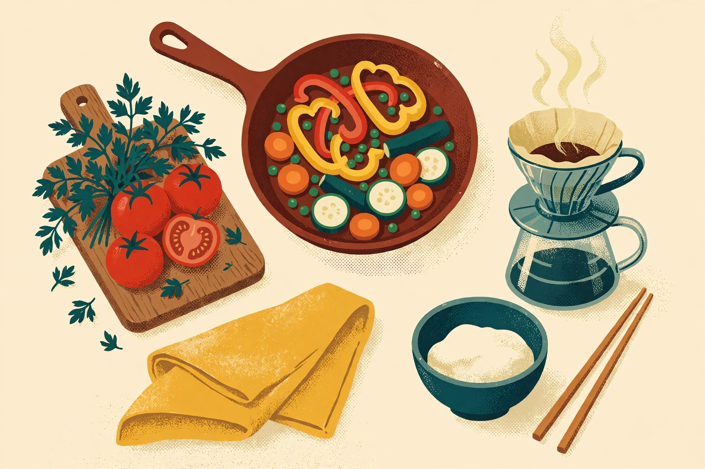

做饭手忙脚乱，多半不是手艺问题，是顺序问题。备好菜再开火，厨房就从战场变回厨房。

*备菜备好了，做饭就只剩“做”这一件事。*

以前我做饭，常常是这样的：锅烧热了，才发现菜还没洗；菜下锅了，才发现调料没拿出来；手忙脚乱一通，端上桌的菜味道还行，人已经累得不想吃了。后来改了一个顺序，情况完全不一样：先备菜，再开火。

## 备菜，是做饭的一半

备菜的意思，是把所有东西都处理到“可以直接下锅”的状态：菜洗好、切好，分盘装好；调料按顺序摆在手边；米饭提前煮上；连盛菜的盘子都准备好。备菜花的时间，看起来比直接开火多，实际上是把手忙脚乱的时间，提前换成了从容。

备菜还有一个好处：可以提前发现缺东西。缺葱了，趁还没开火去买或者换个做法；发现肉没解冻，还有时间补救。开火之后才发现问题，就只能将就了。

## 开火之后，只做三件事

备好菜再开火，灶台前就只剩三件事：看火、翻炒、调味。不用来回跑，不用边切边炒，火候反而更容易掌握。菜下锅的顺序也清楚了：难熟的先下，易熟的后下，需要久煮的先炖，需要脆口的最后放。

调味也一样，提前想好。咸鲜为主还是酸辣为主，糖放多少，醋什么时候放——想好了再动手，尝味道的时候只做微调，不做大改。一道菜的味道，大半在动手之前就定下来了。

## 一人食，也值得好好吃

一个人吃饭，最容易凑合。但凑合的代价是：吃得不舒服，还浪费了食材。一人食的做法其实更简单：量少，备菜快，一锅一碗就能吃得很好。给自己做一顿像样的饭，不是浪费时间，是把一天里最实在的一件事做好。

> 厨房的秩序，就是生活的秩序：先准备，再行动；准备好了，行动就不慌。

下次做饭，试试这个顺序：先花二十分钟备菜，把一切摆好，再开火。你会发现，做饭没有变难，只是变从容了。而从容，是厨房里最重要的一味调料。

◆ ◆ ◆
