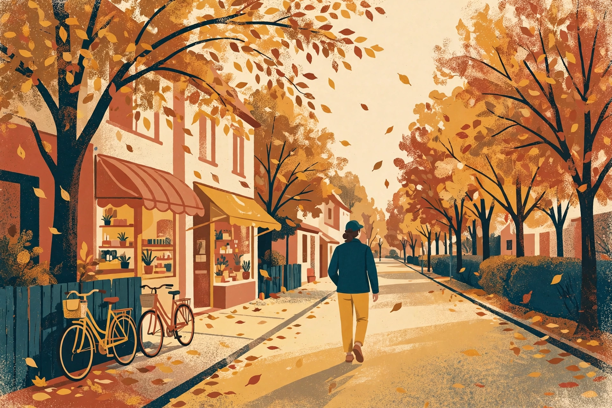

同一条路，走快了是通勤，走慢了是观察。秋天把细节都摆在了眼前，只差一个慢下来的人。

*秋天的路，适合走，不适合赶。*

我有一条固定的散步路线：出门左转，沿着种满行道树的街走到底，再绕回小区门口。全程大约四十分钟。春天走，夏天走，秋天走——同一条路，每个季节都不一样。秋天是它最好看的时候。

秋天的好看，不在远处，在脚下和眼前。落叶铺在路边，踩上去有轻微的沙沙声；阳光斜着穿过树枝，在地上投下长长的影子；街边小店的遮阳篷换了颜色，门口摆出了应季的东西。这些平时赶路时都看不见，因为赶路时眼睛只看前方三米。

## 散步的三个规矩

为了让散步真的“散”起来，我给自己定了三个小规矩。第一，不戴耳机。音乐会把注意力收走，而散步要的就是注意力散开，听风声、脚步声和远处的说话声。第二，不赶时间。走到哪算哪，觉得某棵树好看就停下来看一会儿。第三，带上眼睛，不带目的。不为拍照，不为步数，只为走路本身。

这三个规矩听起来简单，做起来需要一点克制。手机在口袋里震动的时候，手会痒；看到好看的叶子，第一反应是拍照。但拍完照，叶子还是叶子，刚才那一秒的“看见”却过去了。先看够了，再拍也不迟。

## 路上记三行

回家后，我会在备忘录里写三行：今天路上看见了什么。不是游记，是清单。比如：“梧桐叶子黄了一大半”“自行车换了新的车筐”“面包房门口排了队”。三行就够，写多了就成了负担。

这些记录回头看很有意思。它们拼起来，就是一个秋天的样子：哪天叶子开始黄，哪天风开始凉，哪天街上的人开始穿外套。日子不是一天天过去的，是一片叶子一片叶子过去的。

> 散步不是为了到达哪里，是为了在到达之前，看见路上的东西。

如果你也有一条每天走的路，这个秋天，试着慢下来走一次。不用换路线，不用带装备，把脚步放慢三分之一，抬头看看树，低头看看落叶。路还是那条路，秋天却不一样了。

◆ ◆ ◆
